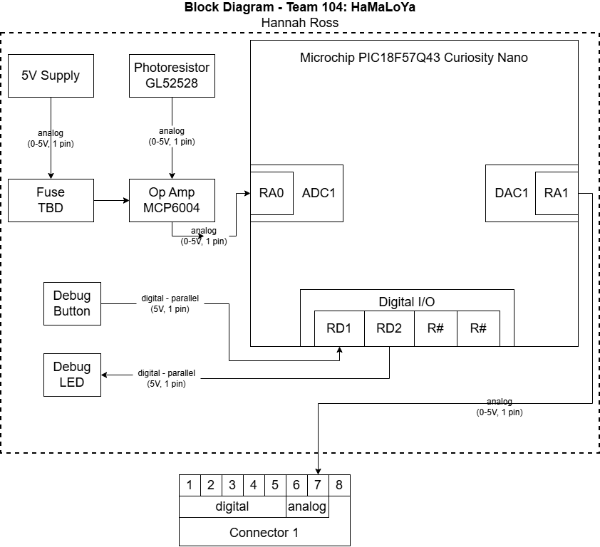

---
title: Individal Block Diagram

## Overview
The block diagram shows the initial subsection of the drowsy driver device. This subsystem reads the light values of the surrounding area and will send an analog signal to the next subsystem to to start the next sensor. The system runs on 5V power, ran through a fuse to ensure power surges don't ruin the components. The fuse is connected to an op amp attached to the photoresistor. The system also includes a button and LED for debugging purposes.

## Block Diagram 
 
 
[link to draw.io](block.drawio)
